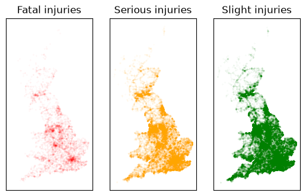
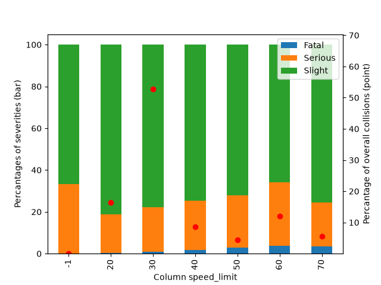
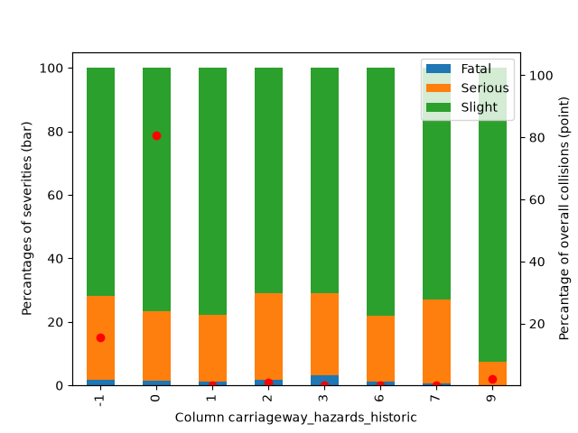
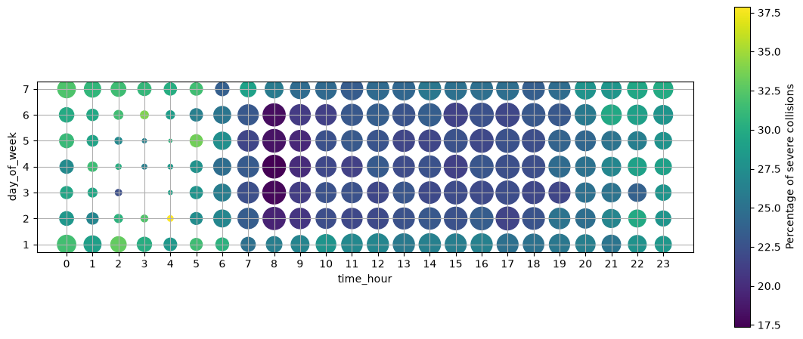
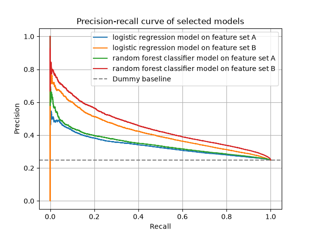
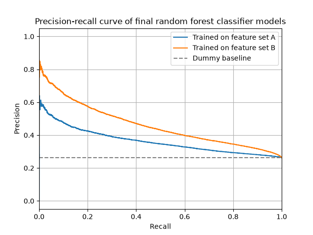
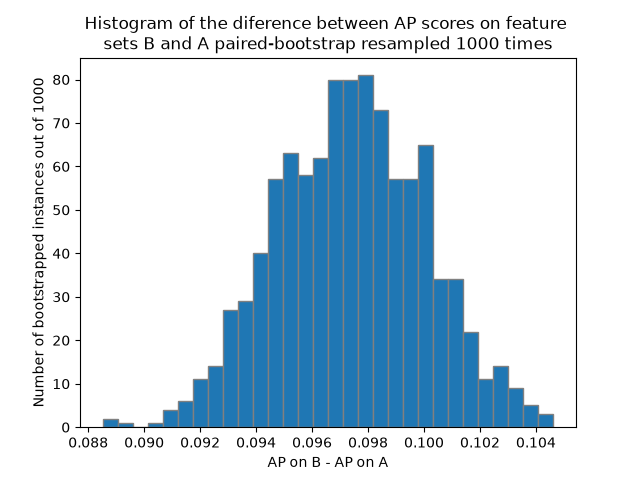

# UK Road collision severity prediction

## About the project
This project implements a full workflow to train a model on publicly available data which predicts road collision severity from known circumstances. The resulting model is intended to be able to make predictions based on information available shortly after a collision occurs – not from just information known before the collision, neither from extra information available after a longer period of time. 

The main questions were:

* How precisely will the model be able to predict severity solely from basic information about the place of the collision?
* How much will the model's performance improve if it is also given more specific information on the vehicles involved?

## The data
The dataset used for this project is composed of information on over 500k road collision instances in the UK. This data has been collected over the years 2021–2025 and it is available on the following website of the UK Government: 

https://www.gov.uk/government/statistical-data-sets/road-safety-open-data

(The raw data files are excluded from this repository and should be downloaded into "data/raw_data/" for reproduction of the project.)

It is split into two files. One contains all the collision instances labeled by collision indices with data about the place and time of the accident (e.g. road type, weather, date). The other contains information about vehicles which were recorded to have participated in said collisions (e.g. type of vehicle, point of impact, age of driver) with each assigned the index of their collision. Only about 6k collisions have no vehicles assigned to them.

Except for a few exceptions like the precise latitude or time of day, a majority of the features are categorical. This made it easier to handle the relatively high number of missing values (it varies from feature to feature, but for example "junction_detail_historic" has more than half of the entries missing).

Also note that each collision is assigned a slight/serious/fatal severity, but for the purpose of this project the target is just a binary feature distinguishing between slight and serious/fatal.

## Exploratory data analysis

The main goal of the exploratory phase was to select features to be used for training the models. The website from which the data was taken also contains a guide containing all the feature names, their descriptions and also a dictionary for the encoding of categorical variables. This allowed for candidate features to be selected for further brief analysis.

One issue was that it is sensible to try to feed the model locational data, however using just the latitude and longitude as final features was not ideal. 

Fortunately, to include data about the location, it was possible to use the feature "police_force". This feature identifies the local police authority which the collision is registered with and thus it breaks up the map of collisions into around 50 regions (a very reasonable number for our purpose). Still, the latitude and longitude could be used in future work on this project for example to create more meaningful clusters.

Other features being analysed were graphed to reveal their distribution.

Here the speed_limit feature provides good context as could be expected, while on the other hand, carriageway_hazards_historic appears to have the same value in a vast majority of the collisions and was thus not used as it would rarely be useful.

Bivariate analysis was also used for further visualisation. For example, the next figure shows the portion of recorded collisions and their severities with respect to both the day of week and time of day, revealing that collisions occurring around 8 am on weekdays are among the most common, but also least severe. 

Importantly, one issue had to be addressed which would otherwise cause leakage: It is reasonable to assume that collisions with different severities will be documented differently. Thus, for example, a collision instance with many missing features might have them because of poor documentation hinting toward lower severity. However, if a model was trained to predict collision severity in real time, it would not have information about the number of features which will not be later documented. 

For this reason, each candidate feature was tested in how many collisions have said feature missing and how does the expected severity change when it is missing. For example, the vehicle feature "age_band_of_driver" is missing in more than 27% of all the vehicle data instances and its absence raises the probability of belonging to a severe collision by almost 8%. To somewhat address this, "junction_control" and "age_band_of_driver" were removed from the selection of features. Furthermore, to treat other features which were similarly problematic in this way and also for the resulting models to be interpretable as predictors of collision severity from information available shortly after the collision, all missing values of all features were imputed to match the most frequent category of their feature.

Furthermore, each categorical feature was one-hot encoded for the models to handle them better. Feature set A was created just from the file containing just the individual collision data. Feature set B was created by joining feature set A with data from the file with vehicle information – each collision instance was joined by all the one-hot encoded vehicle features which had their values given by the number of vehicles associated with the collision for which the feature was present. After the one-hot encoding, feature set A had 138 features and feature set B had 228 features.

These feature sets have further been split, years 2021-2023 went into the training set, 2024 into the validation set and 2025 into the test set. Both the imputer and one-hot encoder were fit just on the training sets to prevent leakage.

## Modelling

Three models were trained on both the preprocessed feature sets with the first one being just a dummy classifier. It just predicted each collision to be severe with probability around 23% (note that the the target is a binary classification of severe/non-severe) as it has learnt to do from the training data targets.

Next, logistic regression classifiers were trained with noticeably better results shown below. Finally random forest classifier models were trained. For its hyperparameter tuning randomised search and grid search were used with scoring based on average precision. The following figure is the precision-recall curve for these models trained on the training set and evaluated on the validation set.

The random forest classifier models were chosen as the final models as they performed better than the logistic regression models on both feature sets.

## Evaluation

For evaluation, data was preprocessed again with the previous training and validation sets merged into new test sets. Models were then retrained on them and tested on the original test set resulting in a final precision-recall curve.

Average precision (AP) and Brier score metrics were used for evaluation. ROC AUC was not used as it is less suitable for datasets with imbalanced classes. 

| Model | AP score | Brier score |
| :--- | :--- | :--- |
| RFC trained on feature set A | 0.3634 | 0.1875 |
| RFC trained on feature set B | 0.4608 | 0.174 |

Clearly, the model trained on feature set B outperformed the one on feature set A. To further verify the 0.0974 increase in AP score from feature set A to feature set B, this improvement was paired-bootstrap resampled 1000 times.

The resulting 95% confidence interval for this difference is [0.0923, 0.1028]. 

## Conclusion

Evaluation shows that the model trained on basic collision-circumstance information noticeably outperformed the prevalence baseline in severity prediction. The second model, whose training data also contained information on involved vehicles, showed fairly better results – the average precision score improved from 0.3634 to 0.4608. The difference in these scores was further paired-bootstrap tested to have a 95% confidence interval [0.0923, 0.1028], statistically supporting this improvement. 

The dataset used is limited to its five-year period, location of the UK and individual features it contains, so conclusions made should not be too general. Nevertheless, these results answer both of the project questions in a moderately positive way. 